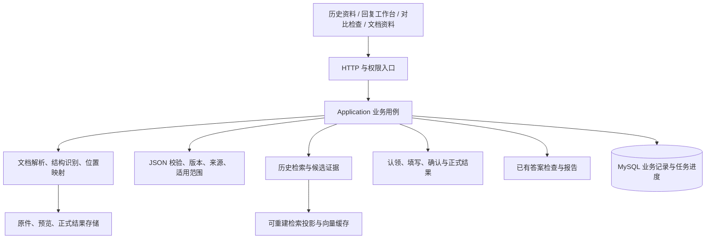

# 验规系统二期详细设计与实施方案

日期：2026-09-21  
状态：设计稿，未实施；不代表数据库迁移、环境复制或功能验收已经完成。

业务基线：[二期需求讨论确认稿](二期需求讨论确认稿-2026-09-21.md)。需求稿的用户确认优先；本稿中的实体名、接口路径和阶段划分是拟采用的实现方案，不新增业务审批。

## 1. 设计结论与文档导航

保留现有 Vue 3、Element Plus、ASP.NET Core、Application/Core/Data 分层和 MySQL 基础。建立独立二期源码、数据库和文件空间，在可复用基础上改造内容模型与业务流程。按少量用户、机构／电控／智能化三个主要部门设计，部门仍可配置。

二期使用同一套文档识别、内容结构、历史检索和原文定位基础，支撑三个业务入口：历史资料维护、部门回复、历史答案对比检查。PDF 和不能结构化的 Word 进入文档资料入口，不强行成为可复用答案。

| 文档 | 内容 |
| --- | --- |
| 本稿 | 架构、页面入口、接口边界、独立环境、实施顺序和验收门禁 |
| [数据契约与迁移设计](phase2/数据契约与迁移设计.md) | JSON、数据表关系、版本、原件、检索投影及一期迁移 |
| [回复工作台与状态设计](phase2/回复工作台与状态设计.md) | 页面操作、认领、编辑、完成、来源核对、正式生成和修订 |
| [历史答案对比检查设计](phase2/历史答案对比检查设计.md) | 库对文件的只读核查、候选分歧、差异报告与快照 |

不开发微服务或独立消息平台作为前提；先使用现有服务与数据库承载有界后台任务。性能不足时先用实测定位瓶颈，再评估新增组件。

## 2. 现状核对与改造边界

本轮只读源码基线：`6d94e77df615e5017031ce1e08e3b937ec1785d0`。此 SHA 表示本地核对起点，不声明远端当前仍相同。需求与设计文档尚未提交，建立副本时需显式带入。

| 现有基础 | 二期处理 |
| --- | --- |
| 登录、公司／组织、角色与菜单权限 | 复用；增加任务参与、同公司资料共享与维护操作权限 |
| Word／Excel 上传、读取、表格预览 | 复用底层能力；统一原件版本、稳定位置及结构化／仅归档两种入口 |
| 固定 Project、Specification、Acceptance、Remark | 所有正文升级为 JSON 字段组，旧字段不再作为新业务独立写入来源 |
| 表头识别结果固定四类列号 | 改成区域＋字段列表＋用途分组；保留原表头和层级 |
| 当前匹配候选按项目＋规格只保留一条 | 保留不同答案、部门、适用条件与版本关系 |
| 当前候选范围超过 5,000 条直接拒绝 | 用分阶段检索、索引及明确的运行预算处理，不把旧门槛直接当二期业务上限 |
| Excel 填充含写回源文件路径 | 二期正式任务从不可变原件渲染派生结果，不修改归档原件 |
| 现有内容版本存储四字段，主记录保存当前 WordFileId | 历史版本升级 JSON；来源绑定具体内容版本，不能随当前文件指针漂移 |
| 文件对比接收 FileIdA／FileIdB，限两个同类型文件 | 保留现有功能；新增独立的历史库对文件核查流程 |
| 执行历史清理选项默认 365 天 | 正式原件、结果及版本记录排除自动到期清理；仅清理安全的临时数据与可重建缓存 |

源码定位：`AcceptanceSpec.cs`、`AcceptanceSpecContentVersion.cs`、`ColumnType.cs`、`DocumentStructureFusion.cs`、`MatchingCandidateProvider.cs`、`SemanticKernelMatchingService.Decisions.cs`、`MatchingWorkflowSupportService.ExcelPersistence.cs`、`FileCompareAppService.cs`、`ExecutionHistoryRetentionOptions.cs`。

这些是改造起点和已发现限制，不代表以上文件是完整改动清单。实现前按用例核对全部读写入口，特别是批量回复、回填历史库、版本恢复、引用记录、清理和执行回放。

## 3. 模块职责

- API 负责请求、身份、响应、下载和进度连接，不把事务散落到控制器。
- Application 负责权限、状态、并发、持久化和文件最终确认顺序。
- Core 负责纯内容结构、识别、候选判断、差异和文档处理算法，不绕过 Application 修改正式业务状态。
- Data 保留关系约束、版本记录、并发令牌和迁移；JSON 不替代权限与状态列。
- 正式内容及业务数据库是事实来源；预览、搜索文本、向量和界面缓存均可重建。

## 4. 页面与入口

沿用当前企业界面的导航、表格、筛选和抽屉交互，不重做整个视觉系统。

| 入口 | 主视图与操作 | 复用位置 |
| --- | --- | --- |
| 我的工作 | 本部门待办、未认领、未填完、候选待选、来源待核对 | 新业务首页或工作台入口 |
| 历史资料 | 按范围、部门、有效性筛选；导入、编辑、版本、来源、停用／删除 | `web/src/views/base-data/specs` 与 `data-import` |
| 回复任务 | 创建任务、参与部门、来源组合、进度、取消、转交、结果版本 | 在 `smart-fill` 基础上拆分任务页与填写工作台 |
| 历史对比检查 | 上传已填文件、范围识别、选择历史范围、差异报告 | 新入口，复用现有差异网格和定位能力 |
| 文档资料 | 搜索、分类、版本、预览、下载、仅归档上传 | 新入口，与结构化历史共享原件存储基础 |
| 模板管理 | 表头结构、分组、区域规则、适用模板版本、修改记录 | 复用现有识别规则配置基础 |

资料查询与新任务不隐藏无来源／范围未知的历史记录，但明确其“仅供参考”资格。普通表格不显示模型参数、向量维度或数据库技术字段。

### 4.1 统一结构识别界面

原文件视图保留 Sheet／表格层级。识别区域旁展示字段名称、物理位置、需求／答案／上下文／不参与分组和数据范围。按真实数据预览组合效果。

已确认结构可直接继续，疑问集中显示。新配置默认只用于当前任务；保存模板是独立明确动作。各区域可以不同，确认过的区域先进入工作，未解决区域始终在范围总览中可见。

### 4.2 操作反馈

- 搜索、识别、匹配和生成分别显示进度，不用单一旋转图标覆盖全部任务。
- 显示已保存／保存中／保存失败及最新保存时间。
- 采用候选前可就地对照现有答案、候选完整答案及来源原文。
- 支持连续下一条和批量认领；批量确认仍执行每条完成条件并列出未成功项。
- 关闭页面不取消持久化任务；用户明确取消操作才改变业务状态。

## 5. 权限设计

在现有角色权限上增加动作权限，示例名称不是最终编码：

| 动作 | 约束 |
| --- | --- |
| 读取正式历史／原件／文档资料 | 同公司且具有资料读取权限；原件默认同公司共享预览下载 |
| 新增／维护／停用／删除历史 | 所属部门的资料维护权限；不能由引用关系取得来源维护权 |
| 读取任务／认领／填写／完成 | 任务参与部门＋相应填写权限；写入时核对当前部门认领 |
| 管理参与部门／转交负责人／取消／正式生成 | 当前负责人＋任务管理权限，服务端校验身份和状态 |
| 发布共享模板 | 模板维护权限；单次结构调整不等于发布模板 |
| 创建对比检查／读取报告 | 对目标文件、参照资料及报告具有公司内对应权限；不要求先建立回复任务 |

后台任务在执行及最终保存前重新校验必要的业务状态，不能永久沿用提交时已经失效的部门成员关系。下载端点校验访问资格，不直接暴露存储绝对路径。

部门删除或人员离职不能物理级联删除已有确认署名；历史保留名称快照。身份可用性变化不自动改变过去正式文件的内容。

## 6. 拟定接口边界

二期增量接口统一使用 `/api/v2` 前缀，最终路径在实现时对照现有路由调整。写请求包含幂等键；修改现有记录或状态时携带期望版本。

| 资源 | 主要接口与语义 |
| --- | --- |
| 文档 | `POST /documents` 上传原件；`GET /documents` 查找；`GET /documents/{id}/versions`；`GET /document-versions/{id}/preview`、`/download` |
| 识别 | `POST /document-versions/{id}/recognitions`；`GET /recognitions/{id}`；确认映射后生成不可变 mappingVersion |
| 模板 | `GET/POST /mapping-templates`；显式发布新模板版本；已有 mappingVersion 不变化 |
| 导入草稿 | `POST /imports`；`GET /imports/{id}`；`POST /imports/{id}/confirm`；请求绑定文件、映射、质量检查及差异确认版本 |
| 历史资料 | `GET /specs`；`POST /specs`；`POST /specs/{id}/versions`；`GET /specs/{id}/versions`；恢复创建新版本 |
| 历史检索 | `POST /spec-searches`，传来源范围组合、需求字段组、目标上下文和用途；返回候选、资格、证据、运行完整性 |
| 回复任务 | `POST /reply-tasks`；参与部门增减、转交负责人和取消均为明确动作接口 |
| 条目 | `POST /reply-items/{id}/claim`、`/release`、`/transfer`；`PUT /reply-items/{id}/answer`；`POST /reply-items/{id}/complete`、`/not-applicable`、`/source-review` |
| 任务检索 | `POST /reply-task-revisions/{id}/matches`；范围调整只作用于指定条目，保存实际来源范围与版本快照，不覆盖已填答案 |
| 正式结果 | `POST /reply-task-revisions/{id}/generate`；`GET /reply-results/{id}`、`/download`；修订创建新的工作版本 |
| 选择入库 | `POST /reply-results/{id}/knowledge-imports`，部门显式选择条目及新增／更新方式 |
| 历史检查 | `POST /history-checks`；进度、报告、报告下载及取消，详见检查设计 |

共通错误区分：权限不足、版本冲突、字段映射失效、答案未完成、范围有疑问、来源待核对、检索服务不可用、后台任务失败。失败不能返回空列表并伪装为无历史依据。

采用候选需携带匹配运行、候选内容／状态修订、条目与来源范围期望版本；服务端采用时重新核对，不能仅相信页面曾展示过该候选。

分页列表返回轻量摘要，按需读取详细 JSON 与原文，不在每次列表查询反序列化全部历史版本或整份文件。

## 7. 后台任务与恢复

复用 ASP.NET Core 宿主与资源预算机制，新增持久化 Job 记录：任务类型、主体 ID、输入版本指纹、状态、阶段、进度、错误、尝试次数、执行租约、取消请求、结果引用。

- 文件结构识别、语义匹配、Word 预览生成、报告及正式文件生成均可分阶段执行。
- 队列通知只负责唤醒，数据库记录是重启后恢复依据。
- 相同输入指纹重试复用已完成阶段；失效输入不能继续写入新任务版本。
- 工作线程完成一次步骤前核对租约和取消状态，避免重复提交。
- AI 不可用时明确标识 AI 步骤失败，用户可主动进入手动配置、搜索或填写模式；不能将手动结果描述为 AI 成功。
- 已确认区域和人工答案不因局部失败清空；重新识别产生待核对的新建议，不自动替换现有配置。
- 大文件超出经验证的资源边界时明确报告，不能静默截断行、字段或候选后宣布完整完成。

文件写入先生成临时派生文件并校验，再由业务事务确认结果引用。崩溃后的孤儿文件可回收，但在用原件、被引用版本及正式结果不进入临时清理。

## 8. 独立二期开发目录

### 8.1 目标与当前状态

用户计划新建目录复制一期后开发。本轮只制定方案，没有创建新目录、分支、数据库或启动服务。目标绝对路径尚待指定；例如 `D:\Temp\AcceptanceSpecificationSystemV2` 仅为建议，不视为实际目录。

推荐通过 Git 创建保留历史的独立本地副本，在 `codex/phase2` 一类功能分支上开发；不复制 `.git` 工作状态来冒充一次可追踪的升级，不改写一期仓库历史。

### 8.2 拷贝与初始化清单

| 内容 | 处理 |
| --- | --- |
| 已跟踪源代码、锁文件、测试、脚本 | 从核对的 Git 基线建立副本 |
| 本次需求与设计文档 | 当前为未提交文件，按明确清单单独复制并核对 |
| 当前其他未提交内容 | 先列出差异，由范围决定是否带入；不一并暂存、提交或恢复 |
| bin、obj、node_modules、dist、日志、缓存 | 不复制，按现有锁文件恢复依赖和构建 |
| 数据库备份、真实上传文件、业务样本 | 仅复制明确选定的演练数据；按原件副本和清单核对，不沿用一期可写路径 |
| 本地环境配置、生产配置、密钥 | 从示例创建独立配置；不能盲目沿用现有连接或凭据 |
| 远端 | 新副本先以本地开发为目标，不自行创建或推送远端 |

源码可追踪基线和需求文件清单同时记录。正式开始准备目录前，重新核对一期工作树，保护这期间的用户变化。

### 8.3 真正隔离的运行边界

- 新数据库／账号仅可写二期开发或演练数据库。
- 上传原件、预览、正式结果、日志、备份、临时目录均使用二期路径。
- 使用独立端口、应用数据保护密钥和后台任务配置。
- 首次启动前输出脱敏的环境目标核对结果：数据库标识、文件根目录、端口、迁移与后台清理开关。
- 不共享一期写库凭据或可写挂载。涉及真实数据的复制或迁移在准确目标明确后单独执行。
- 当前程序存在清理、备份、模型预热等后台服务，不能在仅复制目录后直接假定它们已隔离。
- 演练阶段禁止自动把旧结构迁移到一期数据库；二期迁移使用显式命令和版本门禁。

## 9. 实施阶段与退出条件

阶段顺序体现依赖；每个阶段都应能演示具体产物，不一次性重写全部系统。

| 阶段 | 工作内容 | 可审阅结果／退出条件 |
| --- | --- | --- |
| P0 设计与样本 | 确认稿、详细设计、代表性 Word／Excel／PDF、旧数据盘点 | 字段／条目／来源模型能表达样本；识别失败有明确处理路径 |
| P1 独立环境 | 建副本、功能分支、独立配置／数据库／文件空间、一期基线冒烟 | 一期不受影响；二期目标核对完成；未改业务前可运行原流程 |
| P2 内容与原件基础 | JSON、内容版本、来源、字段映射、迁移工具首版 | 当前与历史版本无损读取；原件可追溯；旧数据迁移报告可审阅 |
| P3 识别与历史检索 | 动态表头、字段组、范围组合、候选与冲突、模板复用 | 多格式样本可导入检索；不同答案不被误去重；无生成式承诺 |
| P4 历史对比检查 | 上传已填文件、条目对应、整组比较、版本化报告 | 能可靠展示一致／差异／无依据／未能检查，完全只读 |
| P5 部门回复工作台 | 参与、认领、接手、保存、候选选择、完成、取消／转交 | 多部门并发不覆盖；来源待核对和未完成确实阻止正式生成 |
| P6 正式文件与资料归档 | 结果生成、重试恢复、修订、选择入库、文档库与预览完善 | 原件不被改写；正式版本可重复下载；无法结构化文件可找到并预览 |
| P7 综合演练 | 全量迁移演练、业务样本、故障恢复、容量和体验核对 | 迁移前后保真与实际可用性通过；未满足项明确列出，不以编译代替验收 |

文档资料的基础原件和预览接口在 P2 开始验证，P6 完成管理交互，避免到末期才发现 Word 预览不可用。P4 提前验证内容基础，也可在回复工作台未完成前单独演示客户提出的检查能力。

## 10. 验收与证明边界

验证沿用现有后端测试、前端类型检查和交互测试基础。局部改动做定向检查；JSON、权限、状态或文件链路的阶段集成属于跨模块改造，在阶段完成时执行相应完整构建和必要回归。

| 层次 | 需要证明 |
| --- | --- |
| 契约 | JSON round-trip、空值／空串、字段顺序、稳定 ID、模板快照、重复来源 |
| 数据库 | 并发认领、版本冲突、完成状态、迁移可重入、引用与来源不串版本 |
| 文档 | 真实 Word／Excel 输入，合并区域、公式、原有答案、样式和结果保存 |
| AI 边界 | 结构识别可校验；检索失败不伪装无依据；硬条件冲突不因模型高分变成自动采用 |
| 浏览器业务 | 机构、电控、智能化多会话实际认领、接手、撤回、移除、来源核对和导出 |
| 故障恢复 | 识别／保存／生成失败，断线、取消和重启后不丢已确认工作，不重复正式记录 |
| 迁移效果 | 旧记录及版本保真、资格分布、真实检索、恢复、对比和回填能力 |

正式检查报告中的“与历史一致”仅表示在本次已冻结范围和依据下的对照结果，不能宣称设备或业务承诺已经通过验收。

性能指标用样本测量后确定，至少记录文件规模、记录数、耗时、峰值资源、失败率及人工操作量；不预先许诺未经验证的秒数或准确率。

## 11. 开始实现前的短清单

需要指定或实测的事项保留在此，不继续无限追加功能：

1. 二期目录的绝对路径及是否确实使用独立 Git 副本。
2. 经授权的演练数据库与文件副本来源，以及脱敏范围。
3. 代表性样本，包括无项目列、合并回复、多行表头、多个候选和无法结构化文档。
4. Word 预览转换方案的样本验证；若需要新增依赖，提供选型和影响后确认，不自动安装。
5. 对比报告首版建议为站内报告＋可下载明细，具体导出格式见检查设计。
6. 独立全库聊天界面暂不作为上述阶段的前置条件；首版不突破不生成新验规答案的边界。

本稿不包含生产执行指令。真实环境更新另按仓库 `docs/DEPLOY-WINDOWS-DOCKER.md` 核对准确目标、版本、备份和迁移流程；本地演练成功不等于真实环境已升级。
